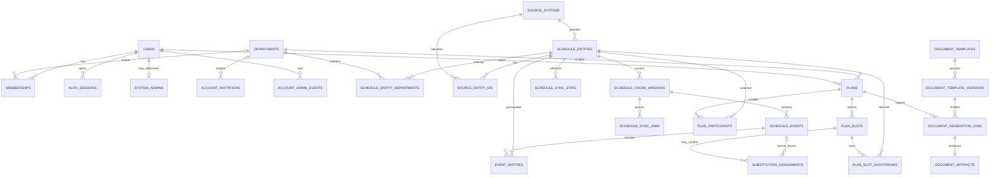

# Черновик модели данных backend

**Статус:** проект схемы для обсуждения; не миграция и не готовый backend.

Проект предназначен для внутреннего использования в ОмГТУ: сначала для кафедры ПМиФИ, с возможностью подключить другие кафедры того же вуза. Модель не предполагает отдельных организаций-клиентов или публичной регистрации.

Цель — перенести запросы к API расписания за Python/FastAPI, хранить обновляемый кэш и пользовательские планы в PostgreSQL. В текущем проекте есть только Svelte/Vite: браузер запрашивает `/api`, а nginx/Vite проксируют запросы к `rasp.omgtu.ru`. Предлагаемая граница: браузер → FastAPI → PostgreSQL и API ОмГТУ. Внешний API вызывают фоновые задачи, а не пользовательские запросы.

## Области данных

1. **Аккаунты и доступ:** пользователи единственного вуза, кафедры, членство, приглашения, администраторы, сессии и журнал действий с учётными записями.
2. **Справочник источника:** преподаватели, группы и аудитории с внешними ID. Их записи не смешиваются с аккаунтами пользователей.
3. **Кэш расписания:** нормализованные занятия, связи с участниками, последние ответы внешнего API и состояние синхронизации.
4. **Планы пользователей:** консультации, пересдачи, встречи и замены; выбранные участники, слоты, аудитории и подтверждения.

Отдельная таблица вуза не требуется: область системы — ОмГТУ, а основная граница доступа — кафедра. В первой конфигурации доступна кафедра ПМиФИ; подключение других кафедр выполняется администратором внутри того же вуза. Общие параметры, например часовой пояс, задаются конфигурацией приложения.

Каждая область имеет собственные таблицы и внешние ключи. Новые сценарии планирования добавляются новым значением `plans.kind` и, если нужны особые поля или ограничения, таблицами-расширениями с FK на `plans.id`.

Сценарии создания аккаунтов и экран управления описаны в [backend-administration.md](backend-administration.md); генерация Word-документов — в [backend-documents.md](backend-documents.md).

## ER-модель



## Основные таблицы

Ниже — PostgreSQL-эскиз ключевых ограничений. Миграции следует вести через Alembic; типы и индексы уточнить после проверки реальных ответов API.

```sql
CREATE EXTENSION IF NOT EXISTS citext;

CREATE TABLE departments (
  id uuid PRIMARY KEY DEFAULT gen_random_uuid(),
  name text NOT NULL UNIQUE,
  source_key text UNIQUE,
  timezone text -- NULL: используется часовой пояс из конфигурации вуза
);

CREATE TABLE users (
  id uuid PRIMARY KEY DEFAULT gen_random_uuid(),
  email citext NOT NULL UNIQUE,
  password_hash text, -- NULL до установки пароля или при входе через внешний провайдер
  display_name text NOT NULL,
  email_verified_at timestamptz,
  activated_at timestamptz,
  disabled_at timestamptz,
  last_login_at timestamptz,
  created_at timestamptz NOT NULL DEFAULT now(),
  updated_at timestamptz NOT NULL DEFAULT now()
);

CREATE TABLE system_admins (
  user_id uuid PRIMARY KEY REFERENCES users(id) ON DELETE RESTRICT,
  granted_by uuid REFERENCES users(id) ON DELETE SET NULL,
  granted_at timestamptz NOT NULL DEFAULT now(),
  revoked_at timestamptz
);

CREATE TABLE system_bootstrap_tokens (
  id uuid PRIMARY KEY DEFAULT gen_random_uuid(),
  email citext NOT NULL,
  token_hash bytea NOT NULL UNIQUE,
  created_at timestamptz NOT NULL DEFAULT now(),
  expires_at timestamptz NOT NULL,
  consumed_at timestamptz,
  revoked_at timestamptz,
  identity_verified_at timestamptz,
  identity_verification_method text,
  identity_verifier text,
  CHECK (expires_at > created_at),
  CHECK (identity_verified_at IS NULL OR identity_verification_method IS NOT NULL)
);
CREATE UNIQUE INDEX system_bootstrap_one_pending_uq
  ON system_bootstrap_tokens ((true))
  WHERE consumed_at IS NULL AND revoked_at IS NULL;

CREATE TABLE memberships (
  id uuid PRIMARY KEY DEFAULT gen_random_uuid(),
  user_id uuid NOT NULL REFERENCES users(id) ON DELETE CASCADE,
  department_id uuid REFERENCES departments(id) ON DELETE CASCADE,
  role text NOT NULL CHECK (role IN ('admin', 'planner', 'viewer')),
  status text NOT NULL DEFAULT 'active' CHECK (status IN ('active', 'suspended', 'revoked')),
  version integer NOT NULL DEFAULT 1 CHECK (version > 0),
  created_at timestamptz NOT NULL DEFAULT now(),
  updated_at timestamptz NOT NULL DEFAULT now()
);
CREATE UNIQUE INDEX memberships_university_scope_uq ON memberships (user_id)
  WHERE department_id IS NULL;
CREATE UNIQUE INDEX memberships_department_scope_uq ON memberships (user_id, department_id)
  WHERE department_id IS NOT NULL;

-- Дополнительное право обходить известный конфликт источника, scoped к членству.
CREATE TABLE membership_permissions (
  membership_id uuid NOT NULL REFERENCES memberships(id) ON DELETE CASCADE,
  permission text NOT NULL CHECK (permission IN ('override_source_conflict')),
  granted_by uuid REFERENCES users(id) ON DELETE SET NULL,
  granted_at timestamptz NOT NULL DEFAULT now(),
  PRIMARY KEY (membership_id, permission)
);

CREATE TABLE account_invitations (
  id uuid PRIMARY KEY DEFAULT gen_random_uuid(),
  department_id uuid REFERENCES departments(id),
  email citext NOT NULL,
  target_user_id uuid REFERENCES users(id) ON DELETE SET NULL,
  role text NOT NULL CHECK (role IN ('admin', 'planner', 'viewer')),
  token_hash bytea NOT NULL UNIQUE,
  status text NOT NULL DEFAULT 'pending'
    CHECK (status IN ('pending', 'accepted', 'expired', 'revoked')),
  invited_by uuid REFERENCES users(id) ON DELETE SET NULL,
  accepted_by uuid REFERENCES users(id) ON DELETE SET NULL,
  identity_verified_by uuid REFERENCES users(id) ON DELETE SET NULL,
  identity_verified_at timestamptz,
  identity_verification_method text,
  created_at timestamptz NOT NULL DEFAULT now(),
  expires_at timestamptz NOT NULL,
  accepted_at timestamptz,
  revoked_at timestamptz,
  CHECK (expires_at > created_at),
  CHECK (identity_verified_at IS NULL OR identity_verification_method IS NOT NULL),
  CHECK (status <> 'accepted' OR accepted_at IS NOT NULL),
  CHECK (status <> 'revoked' OR revoked_at IS NOT NULL)
);
CREATE UNIQUE INDEX account_invitation_university_pending_uq
  ON account_invitations (email)
  WHERE department_id IS NULL AND status = 'pending';
CREATE UNIQUE INDEX account_invitation_department_pending_uq
  ON account_invitations (department_id, email)
  WHERE department_id IS NOT NULL AND status = 'pending';

CREATE TABLE account_admin_events (
  id bigserial PRIMARY KEY,
  department_id uuid REFERENCES departments(id) ON DELETE SET NULL,
  department_snapshot text,
  actor_id uuid REFERENCES users(id) ON DELETE SET NULL,
  actor_snapshot text,
  target_user_id uuid REFERENCES users(id) ON DELETE SET NULL,
  action text NOT NULL,
  details jsonb NOT NULL DEFAULT '{}'::jsonb,
  request_id text,
  created_at timestamptz NOT NULL DEFAULT now()
);
CREATE INDEX account_admin_events_department_idx ON account_admin_events (department_id, created_at DESC);
CREATE INDEX account_admin_events_target_idx ON account_admin_events (target_user_id, created_at DESC);

CREATE TABLE auth_sessions (
  id uuid PRIMARY KEY DEFAULT gen_random_uuid(),
  user_id uuid NOT NULL REFERENCES users(id) ON DELETE CASCADE,
  refresh_token_hash bytea NOT NULL UNIQUE,
  created_at timestamptz NOT NULL DEFAULT now(),
  expires_at timestamptz NOT NULL,
  revoked_at timestamptz,
  rotated_from_id uuid REFERENCES auth_sessions(id),
  user_agent text,
  ip_hash bytea
);

CREATE TABLE source_systems (
  id smallint GENERATED ALWAYS AS IDENTITY PRIMARY KEY,
  key text NOT NULL UNIQUE,
  base_url text NOT NULL,
  enabled boolean NOT NULL DEFAULT true,
  settings jsonb NOT NULL DEFAULT '{}'::jsonb
);

CREATE TABLE source_catalog_sync_state (
  source_id smallint NOT NULL REFERENCES source_systems(id) ON DELETE CASCADE,
  kind text NOT NULL CHECK (kind IN ('teacher', 'group', 'auditorium', 'building')),
  scope_key text NOT NULL DEFAULT 'all', -- например, building:16 для списка аудиторий корпуса
  last_success_at timestamptz,
  next_attempt_at timestamptz NOT NULL DEFAULT now(),
  failure_count integer NOT NULL DEFAULT 0 CHECK (failure_count >= 0),
  etag text,
  last_error text,
  PRIMARY KEY (source_id, kind, scope_key)
);

CREATE TABLE schedule_entities (
  id uuid PRIMARY KEY DEFAULT gen_random_uuid(),
  source_id smallint NOT NULL REFERENCES source_systems(id),
  kind text NOT NULL CHECK (kind IN ('teacher', 'group', 'auditorium', 'building')),
  display_name text NOT NULL,
  attributes jsonb NOT NULL DEFAULT '{}'::jsonb,
  inactive_at timestamptz,
  first_seen_at timestamptz NOT NULL DEFAULT now(),
  last_seen_at timestamptz NOT NULL DEFAULT now(),
  UNIQUE (id, source_id, kind)
);
CREATE INDEX schedule_entities_name_idx ON schedule_entities (kind, lower(display_name));

-- Только фактические обращения пользователей; фоновое обновление не продлевает срок.
CREATE TABLE schedule_entity_usage (
  entity_id uuid PRIMARY KEY REFERENCES schedule_entities(id) ON DELETE CASCADE,
  last_accessed_at timestamptz NOT NULL
);
CREATE INDEX schedule_entity_usage_recent_idx ON schedule_entity_usage (last_accessed_at);

CREATE TABLE schedule_entity_departments (
  entity_id uuid NOT NULL REFERENCES schedule_entities(id) ON DELETE CASCADE,
  department_id uuid NOT NULL REFERENCES departments(id),
  origin text NOT NULL CHECK (origin IN ('source', 'manual')),
  last_seen_at timestamptz,
  PRIMARY KEY (entity_id, department_id)
);
CREATE INDEX schedule_entity_departments_lookup_idx ON schedule_entity_departments (department_id, entity_id);

-- ID словаря и ID поиска могут относиться к разным пространствам идентификаторов.
CREATE TABLE source_entity_ids (
  entity_id uuid NOT NULL,
  source_id smallint NOT NULL,
  kind text NOT NULL,
  id_namespace text NOT NULL,
  external_id text NOT NULL,
  is_current boolean NOT NULL DEFAULT true,
  observed_at timestamptz NOT NULL DEFAULT now(),
  PRIMARY KEY (source_id, kind, id_namespace, external_id),
  FOREIGN KEY (entity_id, source_id, kind)
    REFERENCES schedule_entities(id, source_id, kind)
);
CREATE UNIQUE INDEX source_entity_ids_current_uq ON source_entity_ids (entity_id, id_namespace)
  WHERE is_current;

CREATE TABLE schedule_entity_aliases (
  id uuid PRIMARY KEY DEFAULT gen_random_uuid(),
  entity_id uuid NOT NULL REFERENCES schedule_entities(id) ON DELETE CASCADE,
  alias text NOT NULL,
  origin text NOT NULL CHECK (origin IN ('source', 'manual')),
  created_at timestamptz NOT NULL DEFAULT now(),
  UNIQUE (entity_id, alias)
);
CREATE INDEX schedule_entity_aliases_name_idx ON schedule_entity_aliases (lower(alias));

CREATE TABLE user_teacher_profiles (
  user_id uuid NOT NULL REFERENCES users(id) ON DELETE CASCADE,
  teacher_entity_id uuid NOT NULL REFERENCES schedule_entities(id),
  is_primary boolean NOT NULL DEFAULT false,
  verified_by uuid REFERENCES users(id) ON DELETE SET NULL,
  verification_method text NOT NULL,
  linked_at timestamptz NOT NULL DEFAULT now(),
  PRIMARY KEY (user_id, teacher_entity_id)
);
CREATE UNIQUE INDEX user_teacher_primary_uq ON user_teacher_profiles (user_id)
  WHERE is_primary;
CREATE UNIQUE INDEX teacher_profile_account_uq ON user_teacher_profiles (teacher_entity_id);

CREATE TABLE schedule_cache_windows (
  id uuid PRIMARY KEY DEFAULT gen_random_uuid(),
  entity_id uuid NOT NULL REFERENCES schedule_entities(id) ON DELETE CASCADE,
  range_start date NOT NULL,
  range_end date NOT NULL,
  last_success_at timestamptz,
  stale_after timestamptz,
  last_success_payload jsonb,
  last_attempt_at timestamptz,
  last_error text,
  next_attempt_at timestamptz NOT NULL DEFAULT now(),
  failure_count integer NOT NULL DEFAULT 0 CHECK (failure_count >= 0),
  UNIQUE (entity_id, range_start, range_end),
  CHECK (range_end >= range_start),
  CHECK ((last_success_at IS NULL) = (last_success_payload IS NULL))
);
CREATE INDEX schedule_cache_windows_due_idx ON schedule_cache_windows (next_attempt_at);

CREATE TABLE schedule_events (
  id uuid PRIMARY KEY DEFAULT gen_random_uuid(),
  source_id smallint NOT NULL REFERENCES source_systems(id),
  window_id uuid NOT NULL REFERENCES schedule_cache_windows(id) ON DELETE CASCADE,
  external_key text, -- только проверенный идентификатор источника
  observation_key text NOT NULL, -- уникален внутри одного успешного ответа
  event_date date NOT NULL,
  timezone text NOT NULL, -- часовой пояс источника на дату события
  slot_number smallint CHECK (slot_number > 0),
  slot_number_end smallint CHECK (slot_number_end > 0),
  starts_at time,
  ends_at time,
  discipline text NOT NULL DEFAULT '',
  kind_of_work text,
  subgroup text,
  source_payload jsonb NOT NULL DEFAULT '{}'::jsonb,
  content_hash bytea NOT NULL,
  fetched_at timestamptz NOT NULL,
  UNIQUE (window_id, observation_key),
  CHECK (ends_at IS NULL OR starts_at IS NULL OR ends_at > starts_at),
  CHECK (slot_number_end IS NULL OR slot_number IS NULL OR slot_number_end >= slot_number)
);
CREATE INDEX schedule_events_date_idx ON schedule_events (event_date, slot_number);

CREATE TABLE schedule_event_subgroups (
  id uuid PRIMARY KEY DEFAULT gen_random_uuid(),
  event_id uuid NOT NULL REFERENCES schedule_events(id) ON DELETE CASCADE,
  ordinal integer NOT NULL CHECK (ordinal >= 0),
  parent_group_entity_id uuid REFERENCES schedule_entities(id),
  source_subgroup_oid text,
  display_name text,
  source_payload jsonb NOT NULL DEFAULT '{}'::jsonb,
  UNIQUE (event_id, ordinal)
);

CREATE TABLE event_entities (
  event_id uuid NOT NULL REFERENCES schedule_events(id) ON DELETE CASCADE,
  entity_id uuid NOT NULL REFERENCES schedule_entities(id),
  role text NOT NULL CHECK (role IN ('teacher', 'group', 'auditorium')),
  PRIMARY KEY (event_id, entity_id, role)
);
CREATE INDEX event_entities_lookup_idx ON event_entities (entity_id, event_id);

CREATE TABLE schedule_fetches (
  id bigserial PRIMARY KEY,
  window_id uuid NOT NULL REFERENCES schedule_cache_windows(id) ON DELETE CASCADE,
  attempted_at timestamptz NOT NULL DEFAULT now(),
  completed_at timestamptz,
  result text NOT NULL CHECK (result IN ('running', 'success', 'partial', 'failed')),
  http_status smallint,
  response_payload jsonb,
  error_code text
);
CREATE INDEX schedule_fetches_latest_idx ON schedule_fetches (window_id, completed_at DESC);

CREATE TABLE schedule_fetch_issues (
  id bigserial PRIMARY KEY,
  fetch_id bigint NOT NULL REFERENCES schedule_fetches(id) ON DELETE CASCADE,
  code text NOT NULL,
  severity text NOT NULL CHECK (severity IN ('warning', 'error')),
  item_ordinal integer CHECK (item_ordinal >= 0),
  created_at timestamptz NOT NULL DEFAULT now()
);

CREATE TABLE cache_window_provenance (
  window_id uuid PRIMARY KEY REFERENCES schedule_cache_windows(id) ON DELETE CASCADE,
  source_fetch_id bigint REFERENCES schedule_fetches(id) ON DELETE SET NULL,
  derivation text NOT NULL CHECK (derivation IN ('direct', 'building')),
  source_building_entity_id uuid REFERENCES schedule_entities(id),
  fetched_at timestamptz NOT NULL,
  CHECK (derivation <> 'building' OR source_building_entity_id IS NOT NULL)
);

CREATE TABLE schedule_sync_state (
  entity_id uuid PRIMARY KEY REFERENCES schedule_entities(id) ON DELETE CASCADE,
  last_attempt_at timestamptz,
  last_success_at timestamptz,
  next_attempt_at timestamptz NOT NULL DEFAULT now(),
  failure_count integer NOT NULL DEFAULT 0 CHECK (failure_count >= 0),
  stale_after timestamptz NOT NULL,
  last_error text
);
CREATE INDEX schedule_sync_due_idx ON schedule_sync_state (next_attempt_at);

CREATE TABLE schedule_sync_jobs (
  id bigserial PRIMARY KEY,
  window_id uuid NOT NULL REFERENCES schedule_cache_windows(id) ON DELETE CASCADE,
  due_at timestamptz NOT NULL,
  status text NOT NULL DEFAULT 'pending'
    CHECK (status IN ('pending', 'running', 'succeeded', 'failed')),
  attempts integer NOT NULL DEFAULT 0,
  locked_until timestamptz,
  lease_token uuid,
  last_error text
);
CREATE INDEX schedule_sync_jobs_claim_idx ON schedule_sync_jobs (due_at, id)
  WHERE status = 'pending';
CREATE UNIQUE INDEX schedule_sync_jobs_active_uq
  ON schedule_sync_jobs (window_id)
  WHERE status IN ('pending', 'running');

CREATE TABLE plans (
  id uuid PRIMARY KEY DEFAULT gen_random_uuid(),
  department_id uuid NOT NULL REFERENCES departments(id),
  owner_id uuid NOT NULL REFERENCES users(id),
  kind text NOT NULL CHECK (kind IN ('consultation', 'retake', 'meeting', 'substitution')),
  title text NOT NULL DEFAULT '',
  status text NOT NULL DEFAULT 'draft'
    CHECK (status IN ('draft', 'submitted', 'confirmed', 'cancelled', 'archived')),
  visibility text NOT NULL DEFAULT 'department'
    CHECK (visibility IN ('private', 'department', 'shared')),
  archived_at timestamptz,
  range_start date,
  range_end date,
  version integer NOT NULL DEFAULT 1,
  metadata jsonb NOT NULL DEFAULT '{}'::jsonb,
  created_at timestamptz NOT NULL DEFAULT now(),
  updated_at timestamptz NOT NULL DEFAULT now(),
  CHECK (range_end IS NULL OR range_start IS NULL OR range_end >= range_start),
  CHECK (visibility <> 'department' OR department_id IS NOT NULL)
);
CREATE INDEX plans_owner_updated_idx ON plans (owner_id, updated_at DESC);
CREATE INDEX plans_scope_status_idx ON plans (department_id, status);

CREATE TABLE plan_participants (
  plan_id uuid NOT NULL REFERENCES plans(id) ON DELETE CASCADE,
  entity_id uuid NOT NULL REFERENCES schedule_entities(id),
  role text NOT NULL CHECK (role IN (
    'organizer_teacher', 'target_teacher', 'substitute_candidate',
    'group', 'commission_member', 'meeting_participant'
  )),
  added_at timestamptz NOT NULL DEFAULT now(),
  PRIMARY KEY (plan_id, entity_id, role)
);

CREATE TABLE plan_slots (
  id uuid PRIMARY KEY DEFAULT gen_random_uuid(),
  plan_id uuid NOT NULL REFERENCES plans(id) ON DELETE CASCADE,
  event_date date NOT NULL,
  timezone text NOT NULL,
  slot_number smallint NOT NULL CHECK (slot_number > 0),
  starts_at time NOT NULL,
  ends_at time NOT NULL,
  status text NOT NULL DEFAULT 'selected'
    CHECK (status IN ('selected', 'confirmed', 'cancelled')),
  note text,
  created_at timestamptz NOT NULL DEFAULT now(),
  UNIQUE (plan_id, event_date, slot_number),
  CHECK (ends_at > starts_at)
);

CREATE TABLE plan_slot_auditoriums (
  plan_slot_id uuid NOT NULL REFERENCES plan_slots(id) ON DELETE CASCADE,
  auditorium_entity_id uuid NOT NULL REFERENCES schedule_entities(id),
  is_primary boolean NOT NULL DEFAULT false,
  PRIMARY KEY (plan_slot_id, auditorium_entity_id)
);

CREATE TABLE substitution_assignments (
  id uuid PRIMARY KEY DEFAULT gen_random_uuid(),
  plan_slot_id uuid NOT NULL REFERENCES plan_slots(id) ON DELETE RESTRICT,
  source_event_id uuid REFERENCES schedule_events(id) ON DELETE SET NULL,
  source_snapshot jsonb NOT NULL, -- дата, пара, предмет, группа/подгруппа, аудитория, преподаватель
  snapshot_version smallint NOT NULL DEFAULT 1,
  source_captured_at timestamptz NOT NULL,
  original_teacher_entity_id uuid NOT NULL REFERENCES schedule_entities(id),
  substitute_teacher_entity_id uuid NOT NULL REFERENCES schedule_entities(id),
  status text NOT NULL DEFAULT 'selected'
    CHECK (status IN ('selected', 'confirmed', 'cancelled')),
  confirmed_by uuid REFERENCES users(id) ON DELETE SET NULL,
  confirmed_at timestamptz,
  request_key uuid NOT NULL,
  created_at timestamptz NOT NULL DEFAULT now(),
  UNIQUE (plan_slot_id, request_key),
  CHECK (original_teacher_entity_id <> substitute_teacher_entity_id),
  CHECK (status <> 'confirmed' OR confirmed_at IS NOT NULL)
);

-- Итог повторной проверки непосредственно перед подтверждением. Снимок не является
-- бессрочным утверждением о свободе; состав содержит только доступные сведения.
CREATE TABLE confirmation_checks (
  id uuid PRIMARY KEY DEFAULT gen_random_uuid(),
  plan_id uuid NOT NULL REFERENCES plans(id) ON DELETE RESTRICT,
  plan_slot_id uuid NOT NULL REFERENCES plan_slots(id) ON DELETE RESTRICT,
  assignment_id uuid REFERENCES substitution_assignments(id) ON DELETE RESTRICT,
  actor_id uuid REFERENCES users(id) ON DELETE SET NULL,
  outcome text NOT NULL CHECK (outcome IN ('clear', 'conflict', 'unknown')),
  reason text,
  checked_at timestamptz NOT NULL DEFAULT now(),
  details jsonb NOT NULL DEFAULT '{}'::jsonb,
  CHECK (outcome = 'clear' OR (reason IS NOT NULL AND length(btrim(reason)) > 0))
);
CREATE INDEX confirmation_checks_plan_idx ON confirmation_checks (plan_id, checked_at DESC);

CREATE TABLE plan_activity (
  id bigserial PRIMARY KEY,
  plan_id uuid NOT NULL REFERENCES plans(id) ON DELETE RESTRICT,
  actor_id uuid REFERENCES users(id) ON DELETE SET NULL,
  actor_snapshot text,
  action text NOT NULL,
  changes jsonb NOT NULL DEFAULT '{}'::jsonb,
  created_at timestamptz NOT NULL DEFAULT now()
);
CREATE INDEX plan_activity_timeline_idx ON plan_activity (plan_id, created_at DESC);

CREATE TABLE user_auth_identities (
  id uuid PRIMARY KEY DEFAULT gen_random_uuid(),
  user_id uuid NOT NULL REFERENCES users(id) ON DELETE CASCADE,
  provider text NOT NULL,
  provider_subject text NOT NULL,
  created_at timestamptz NOT NULL DEFAULT now(),
  UNIQUE (provider, provider_subject)
);
CREATE TABLE user_auth_tokens (
  id uuid PRIMARY KEY DEFAULT gen_random_uuid(),
  user_id uuid NOT NULL REFERENCES users(id) ON DELETE CASCADE,
  kind text NOT NULL CHECK (kind IN ('verify_email', 'reset_password')),
  token_hash bytea NOT NULL UNIQUE,
  expires_at timestamptz NOT NULL,
  consumed_at timestamptz,
  created_at timestamptz NOT NULL DEFAULT now()
);
CREATE TABLE idempotency_keys (
  user_id uuid NOT NULL REFERENCES users(id) ON DELETE CASCADE,
  operation text NOT NULL,
  key text NOT NULL,
  request_hash bytea NOT NULL,
  response_status smallint,
  response_body jsonb,
  created_at timestamptz NOT NULL DEFAULT now(),
  expires_at timestamptz NOT NULL,
  PRIMARY KEY (user_id, operation, key)
);
CREATE TABLE teacher_link_requests (
  id uuid PRIMARY KEY DEFAULT gen_random_uuid(),
  user_id uuid NOT NULL REFERENCES users(id) ON DELETE CASCADE,
  teacher_entity_id uuid NOT NULL REFERENCES schedule_entities(id),
  status text NOT NULL DEFAULT 'pending' CHECK (status IN ('pending', 'approved', 'rejected', 'cancelled')),
  reviewed_by uuid REFERENCES users(id) ON DELETE SET NULL,
  reviewed_at timestamptz,
  created_at timestamptz NOT NULL DEFAULT now(),
  CHECK (status NOT IN ('approved', 'rejected') OR reviewed_at IS NOT NULL)
);
CREATE UNIQUE INDEX teacher_link_requests_pending_uq
  ON teacher_link_requests (user_id, teacher_entity_id) WHERE status = 'pending';

CREATE TABLE user_preferences (
  user_id uuid PRIMARY KEY REFERENCES users(id) ON DELETE CASCADE,
  version integer NOT NULL DEFAULT 1,
  settings jsonb NOT NULL DEFAULT '{}'::jsonb,
  updated_at timestamptz NOT NULL DEFAULT now()
);
CREATE TABLE user_favorites (
  user_id uuid NOT NULL REFERENCES users(id) ON DELETE CASCADE,
  entity_id uuid NOT NULL REFERENCES schedule_entities(id),
  created_at timestamptz NOT NULL DEFAULT now(),
  PRIMARY KEY (user_id, entity_id)
);

CREATE TABLE plan_grants (
  plan_id uuid NOT NULL REFERENCES plans(id) ON DELETE CASCADE,
  user_id uuid NOT NULL REFERENCES users(id) ON DELETE CASCADE,
  access text NOT NULL CHECK (access IN ('view', 'edit', 'confirm')),
  granted_by uuid REFERENCES users(id) ON DELETE SET NULL,
  created_at timestamptz NOT NULL DEFAULT now(),
  PRIMARY KEY (plan_id, user_id)
);
-- Один слот может содержать несколько исходных занятий и замен.
ALTER TABLE plan_slots ADD CONSTRAINT plan_slots_id_plan_uq UNIQUE (id, plan_id);
ALTER TABLE confirmation_checks ADD CONSTRAINT confirmation_checks_slot_plan_fk
  FOREIGN KEY (plan_slot_id, plan_id) REFERENCES plan_slots(id, plan_id) ON DELETE RESTRICT;
CREATE TABLE plan_slot_participants (
  plan_slot_id uuid NOT NULL,
  plan_id uuid NOT NULL,
  entity_id uuid NOT NULL,
  role text NOT NULL,
  PRIMARY KEY (plan_slot_id, entity_id, role),
  FOREIGN KEY (plan_slot_id, plan_id) REFERENCES plan_slots(id, plan_id) ON DELETE CASCADE,
  FOREIGN KEY (plan_id, entity_id, role) REFERENCES plan_participants(plan_id, entity_id, role)
);
CREATE UNIQUE INDEX plan_slot_primary_auditorium_uq ON plan_slot_auditoriums (plan_slot_id)
  WHERE is_primary;

CREATE TABLE substitution_responses (
  assignment_id uuid PRIMARY KEY REFERENCES substitution_assignments(id) ON DELETE RESTRICT,
  status text NOT NULL CHECK (status IN ('not_requested', 'pending', 'accepted', 'declined')),
  responded_by uuid REFERENCES users(id) ON DELETE SET NULL,
  requested_at timestamptz,
  responded_at timestamptz,
  CHECK (status NOT IN ('accepted', 'declined') OR responded_at IS NOT NULL)
);

CREATE TABLE academic_calendar_days (
  id uuid PRIMARY KEY DEFAULT gen_random_uuid(),
  department_id uuid REFERENCES departments(id),
  calendar_date date NOT NULL,
  kind text NOT NULL CHECK (kind IN ('working', 'non_working', 'special', 'unknown')),
  title text,
  origin text NOT NULL CHECK (origin IN ('official', 'manual', 'imported')),
  source_reference text,
  verified_at timestamptz,
  updated_at timestamptz NOT NULL DEFAULT now()
);
CREATE UNIQUE INDEX calendar_university_date_uq ON academic_calendar_days (calendar_date)
  WHERE department_id IS NULL;
CREATE UNIQUE INDEX calendar_department_date_uq ON academic_calendar_days (department_id, calendar_date)
  WHERE department_id IS NOT NULL;

CREATE TABLE bell_schedules (
  id uuid PRIMARY KEY DEFAULT gen_random_uuid(),
  department_id uuid REFERENCES departments(id), -- NULL: расписание звонков вуза
  name text NOT NULL,
  valid_from date NOT NULL,
  valid_until date,
  timezone text NOT NULL,
  CHECK (valid_until IS NULL OR valid_until >= valid_from)
);
CREATE TABLE bell_schedule_slots (
  bell_schedule_id uuid NOT NULL REFERENCES bell_schedules(id) ON DELETE CASCADE,
  slot_number smallint NOT NULL CHECK (slot_number > 0),
  starts_at time NOT NULL,
  ends_at time NOT NULL,
  PRIMARY KEY (bell_schedule_id, slot_number),
  CHECK (ends_at > starts_at)
);

-- Общий лимит источника разделяется всеми процессами worker.
CREATE TABLE source_rate_limits (
  source_id smallint PRIMARY KEY REFERENCES source_systems(id) ON DELETE CASCADE,
  min_interval_ms integer NOT NULL CHECK (min_interval_ms > 0),
  max_in_flight integer NOT NULL CHECK (max_in_flight > 0),
  next_allowed_at timestamptz NOT NULL DEFAULT now(),
  blocked_until timestamptz
);
CREATE TABLE source_request_leases (
  token uuid PRIMARY KEY,
  source_id smallint NOT NULL REFERENCES source_systems(id) ON DELETE CASCADE,
  expires_at timestamptz NOT NULL
);
CREATE INDEX source_request_leases_source_idx ON source_request_leases (source_id, expires_at);

CREATE TABLE notification_preferences (
  user_id uuid NOT NULL REFERENCES users(id) ON DELETE CASCADE,
  event_type text NOT NULL,
  channel text NOT NULL CHECK (channel IN ('in_app', 'email')),
  enabled boolean NOT NULL DEFAULT false,
  PRIMARY KEY (user_id, event_type, channel)
);
CREATE TABLE event_outbox (
  id uuid PRIMARY KEY DEFAULT gen_random_uuid(),
  event_type text NOT NULL,
  aggregate_id uuid NOT NULL,
  payload_version smallint NOT NULL DEFAULT 1,
  payload jsonb NOT NULL,
  occurred_at timestamptz NOT NULL DEFAULT now(),
  delivered_to_queue_at timestamptz
);
CREATE TABLE notification_deliveries (
  id uuid PRIMARY KEY DEFAULT gen_random_uuid(),
  outbox_id uuid NOT NULL REFERENCES event_outbox(id),
  user_id uuid NOT NULL REFERENCES users(id) ON DELETE CASCADE,
  channel text NOT NULL CHECK (channel IN ('in_app', 'email')),
  status text NOT NULL CHECK (status IN ('pending', 'processing', 'sent', 'failed')),
  attempts integer NOT NULL DEFAULT 0,
  next_attempt_at timestamptz NOT NULL DEFAULT now(),
  locked_until timestamptz,
  lease_token uuid,
  sent_at timestamptz,
  read_at timestamptz,
  last_error text,
  UNIQUE (outbox_id, user_id, channel)
);
CREATE INDEX notification_delivery_pending_idx ON notification_deliveries (next_attempt_at)
  WHERE status = 'pending';

CREATE TABLE document_templates (
  id uuid PRIMARY KEY DEFAULT gen_random_uuid(),
  department_id uuid REFERENCES departments(id), -- NULL: общий шаблон вуза
  template_key text NOT NULL,
  document_type text NOT NULL,
  name text NOT NULL,
  created_at timestamptz NOT NULL DEFAULT now()
);
CREATE UNIQUE INDEX document_templates_university_key_uq
  ON document_templates (template_key) WHERE department_id IS NULL;
CREATE UNIQUE INDEX document_templates_department_key_uq
  ON document_templates (department_id, template_key) WHERE department_id IS NOT NULL;

CREATE TABLE document_template_versions (
  id uuid PRIMARY KEY DEFAULT gen_random_uuid(),
  template_id uuid NOT NULL REFERENCES document_templates(id),
  version integer NOT NULL CHECK (version > 0),
  input_schema_version smallint NOT NULL DEFAULT 1,
  status text NOT NULL CHECK (status IN ('draft', 'published', 'retired')),
  storage_key text NOT NULL UNIQUE,
  sha256 bytea NOT NULL CHECK (octet_length(sha256) = 32),
  created_by uuid REFERENCES users(id) ON DELETE SET NULL,
  created_at timestamptz NOT NULL DEFAULT now(),
  published_at timestamptz,
  UNIQUE (template_id, version),
  CHECK (status <> 'published' OR published_at IS NOT NULL)
);

CREATE TABLE document_generation_jobs (
  id uuid PRIMARY KEY DEFAULT gen_random_uuid(),
  plan_id uuid NOT NULL REFERENCES plans(id),
  template_version_id uuid NOT NULL REFERENCES document_template_versions(id),
  requested_by uuid REFERENCES users(id) ON DELETE SET NULL,
  request_key uuid NOT NULL,
  plan_version integer NOT NULL CHECK (plan_version > 0),
  snapshot_version smallint NOT NULL DEFAULT 1,
  input_snapshot jsonb NOT NULL,
  input_sha256 bytea NOT NULL CHECK (octet_length(input_sha256) = 32),
  generator_version text NOT NULL,
  locale text NOT NULL DEFAULT 'ru-RU',
  timezone text NOT NULL,
  status text NOT NULL DEFAULT 'queued'
    CHECK (status IN ('queued', 'running', 'succeeded', 'failed', 'cancelled')),
  attempts integer NOT NULL DEFAULT 0 CHECK (attempts >= 0),
  next_attempt_at timestamptz NOT NULL DEFAULT now(),
  locked_until timestamptz,
  lease_token uuid,
  error_code text,
  created_at timestamptz NOT NULL DEFAULT now(),
  completed_at timestamptz,
  UNIQUE (requested_by, request_key),
  CHECK (status <> 'succeeded' OR completed_at IS NOT NULL)
);
CREATE INDEX document_generation_jobs_due_idx ON document_generation_jobs (next_attempt_at, id)
  WHERE status = 'queued';

CREATE TABLE document_artifacts (
  id uuid PRIMARY KEY DEFAULT gen_random_uuid(),
  job_id uuid NOT NULL UNIQUE REFERENCES document_generation_jobs(id),
  storage_key text NOT NULL UNIQUE,
  filename text NOT NULL,
  content_type text NOT NULL
    CHECK (content_type = 'application/vnd.openxmlformats-officedocument.wordprocessingml.document'),
  byte_size bigint NOT NULL CHECK (byte_size > 0),
  sha256 bytea NOT NULL CHECK (octet_length(sha256) = 32),
  created_at timestamptz NOT NULL DEFAULT now(),
  expires_at timestamptz,
  deleted_at timestamptz
);
```

## Как работает кэш и обновление

`schedule_cache_windows` — источник истины для полноты и возраста кэша по **конкретному объекту и диапазону**. `schedule_events` содержит отдельные наблюдения, относящиеся к этому окну, а `schedule_sync_state` служит только сводкой по объекту. Источник, окно и время последней успешной загрузки возвращаются клиенту. Дополнительные правила, сценарии с ошибками и пример API описаны в [backend-behavior.md](backend-behavior.md).

1. Каталоги преподавателей, групп, корпусов и аудиторий обновляются независимо. ID из словарей и поиска связываются через `source_entity_ids` только после проверки; совпадение имени само по себе не объединяет записи.
2. Горизонт расписания разбивается на одинаково выровненные диапазоны, например календарные недели. Для каждого объекта и окна задача ставится в очередь с разбросом по дню. Перед установкой частоты оценивается возможность обновить все окна за сутки с учётом разрешённого rate limit.
3. Рабочие процессы забирают задания через `FOR UPDATE SKIP LOCKED`. Общие `source_rate_limits` и leases ограничивают частоту и количество одновременных запросов **для всех процессов**, а не только для одного worker. HTTP-запрос выполняется вне длительной транзакции.
4. У задачи есть lease и новый `lease_token` при каждом захвате. Зависшая задача возвращается в очередь; результат старого worker с истёкшей или заменённой lease отклоняется. Ответы `429` и `Retry-After` временно останавливают запросы к источнику; остальные ошибки получают ограниченный backoff с jitter.
5. Только полный, успешно разобранный ответ атомарно заменяет последнее содержимое **своего окна**. Пустой проверенный ответ — успешный кэш с нулём занятий. Ошибка, неполный ответ или неизвестный формат сохраняют предыдущий успешный снимок и причину ошибки.
6. API отдаёт из базы свежие данные или явно помеченный устаревший снимок. Если успешного снимка нет, возвращается состояние `unknown`/`loading`: преподавателя, группу и аудиторию нельзя считать свободными на основании отсутствующих данных.
7. Один и тот же урок может прийти из расписания преподавателя, группы и аудитории. Наблюдения хранятся отдельно по окнам; очищение ответа одного объекта не удаляет занятие из окон других объектов. Подгруппы и параллельные занятия не объединяются по одному только имени или приблизительному fingerprint.

`external_key` используется лишь для действительно проверенного ID источника. Если надёжного ID нет, `observation_key` различает записи **в пределах одного ответа**, сохраняя даже одинаково выглядящие события. Такой ключ не объявляется устойчивым ID занятия: подтверждённая замена сохраняет собственный снимок.

Поля `event_date`, `starts_at` и `ends_at` описывают местное время; событие и сохранённый слот фиксируют свой часовой пояс. По умолчанию используется пояс вуза из конфигурации, который может быть переопределён кафедрой и версией звонков. Технические времена операций в PostgreSQL — `timestamptz`. Сырые ответы и журналы хранятся ограниченное настраиваемое время; последний успешный кэш остаётся доступным даже при ошибках источника.

Связь `event_entities.role` должна совпадать с `schedule_entities.kind`. `plan_slot_auditoriums` принимает только аудитории, а принадлежность к кафедре проверяется для всех ссылок и разрешений. Эти правила закрепляются доменным слоем и, где возможно, ограничениями БД; `jsonb` не заменяет проверки входных данных.

## Сохранённые планы и доступ

- Черновик консультации — `plans(kind='consultation')`; выбранные дата и пара — `plan_slots`; фактически выбранные группы и преподаватели для каждой пары — `plan_slot_participants`; выбранные аудитории — `plan_slot_auditoriums`. Пересдачи и встречи используют тот же каркас.
- В одной паре может быть несколько разных занятий и замен: `substitution_assignments.plan_slot_id` не уникален. Для каждой замены сохраняется собственный снимок занятия и кандидат. Текущая кнопка «Подтвердить замену» фиксирует решение автора; ответ кандидата через `substitution_responses` — отдельный необязательный этап и не подразумевается автоматически.
- По умолчанию план относится к кафедре и виден её участникам; для этого обязательно указать кафедру. `department` открывает просмотр участникам соответствующей кафедры; `shared` открывает доступ явно указанным в `plan_grants`. Дополнительные права выдаются через `membership_permissions`: администратор соответствующей кафедры имеет право обхода по роли, а назначенным сотрудникам оно выдаётся отдельно; приостановка членства отключает это право. `confirmation_checks` хранит результат проверки и обязательную причину для конфликта или неопределённости. Принадлежность slot и assignment к указанному плану и право доступа проверяются сервером в транзакции. Права на уровне вуза или кафедры и разрешение конкретного плана проверяются совместно; доступ по произвольному ID исключается. Матрица прав и разрешённые переходы описаны в [backend-behavior.md](backend-behavior.md).
- `version` нужен для оптимистичной блокировки. Изменение плана, запись `plan_activity` и событие `event_outbox` для уведомлений создаются одной транзакцией. Архивирование не стирает историю; правила хранения и удаления согласуются до запуска.
- Пароли хранятся в виде Argon2id-хеша; refresh token, токены подтверждения почты и сброса пароля — только в виде хеша. Привязку аккаунта к преподавателю выполняет администратор с проверкой личности; совпадение ФИО или email не является доказательством.

## Расширяемость

- Адаптер источника хранит идентификаторы из разных пространств (`dictionary`, `search` и др.) и исходные данные; смена внешнего ID не должна менять внутренний ID сущности. Неоднозначные сопоставления остаются несопоставленными до проверки.
- В `plans` находятся общие поля; дополнительные свойства сценариев переносятся в отдельные таблицы. Справочные роли и виды расширяются миграциями. Общие сценарии редактирования используют version и историю, а не новую таблицу на каждый экран.
- `academic_calendar_days` и версии звонков описывают учебный календарь; запись о выходном не подменяет реальные данные расписания и не позволяет автоматически объявить всех свободными.
- Избранное и настройки находятся в `user_favorites` и `user_preferences`; уведомления — в outbox и заданиях доставки. При отключённом канале события сохраняются в истории, а отправка не блокирует запись плана.
- Шаблоны Word могут быть общими для вуза или относиться к конкретной кафедре. Сервер проверяет соответствие кафедры шаблона и плана, а также право пользователя на план. Снимок входных данных и версия шаблона позволяют понять, на каких данных построен документ; двоичные файлы хранятся в закрытом хранилище.
- Расчёт окон, свободного времени и конфликтов выполняется из актуального кэша и сохранённых слотов. Эти вычисленные состояния не становятся постоянным источником истины.
- План внедрения, политика ошибок, контроль доступа, восстановление и границы первой версии приведены в [backend-behavior.md](backend-behavior.md).

## Открытые решения перед реализацией

1. Горизонт обязательного кэша: семестр, учебный год или иной поддерживаемый API диапазон; частота зависит от числа запросов и лимита источника.
2. Регистрация: локальная учётная запись, университетский SSO или оба варианта; способ проверки преподавателя при привязке аккаунта.
3. Кто может видеть и подтверждать план кафедры, нужны ли запрос согласия заменяющего и внешнее уведомление в первой версии.
4. Сроки хранения истории, снимков исходных ответов, уведомлений и правила удаления аккаунта.
5. Реальный внешний ID занятия и подгруппы, формат ответов API, ограничения частоты и пагинация — проверить до окончательной миграции.
6. Какие из существующих шаблонов использовать первыми, какие у них поля и как долго хранить файлы и снимки входных данных.

Эскиз не заменяет миграцию: перед реализацией нужны проверка DDL на выбранной версии PostgreSQL, ограничения типов ссылок и доменные проверки сценариев.

Подробные результаты проверки источника и правила первой версии: [upstream-api-audit.md](upstream-api-audit.md) и [backend-first-stage.md](backend-first-stage.md). Подгруппы хранятся поэлементно в `schedule_event_subgroups`; `subgroup` остаётся удобным отображаемым полем. Ошибки разбора фиксируются без персональных данных; частичный ответ не заменяет последний подтверждённый успешный. Происхождение производного окна аудитории фиксируется отдельно и обновляется вместе с содержимым окна.

Порядок конкурентных подтверждений, блокировок ресурсов и публикации кэша приведён в [backend-concurrency.md](backend-concurrency.md).
