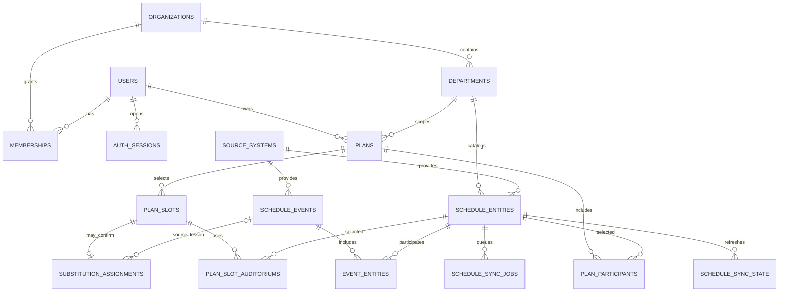

# Черновик модели данных backend

**Статус:** проект схемы для обсуждения; не миграция и не готовый backend.

Цель — перенести запросы к API расписания за Python/FastAPI, хранить обновляемый кэш и пользовательские планы в PostgreSQL. В текущем проекте есть только Svelte/Vite: браузер запрашивает `/api`, а nginx/Vite проксируют запросы к `rasp.omgtu.ru`. Предлагаемая граница: браузер → FastAPI → PostgreSQL и API ОмГТУ. Внешний API вызывают фоновые задачи, а не пользовательские запросы.

## Области данных

1. **Аккаунты и доступ:** пользователи, организации, кафедры, членство и сессии входа.
2. **Справочник источника:** преподаватели, группы и аудитории с внешними ID. Их записи не смешиваются с аккаунтами пользователей.
3. **Кэш расписания:** нормализованные занятия, связи с участниками, последние ответы внешнего API и состояние синхронизации.
4. **Планы пользователей:** консультации, пересдачи, встречи и замены; выбранные участники, слоты, аудитории и подтверждения.

Каждая область имеет собственные таблицы и внешние ключи. Новые сценарии планирования добавляются новым значением `plans.kind` и, если нужны особые поля или ограничения, таблицами-расширениями с FK на `plans.id`.

## ER-модель



## Основные таблицы

Ниже — PostgreSQL-эскиз ключевых ограничений. Миграции следует вести через Alembic; типы и индексы уточнить после проверки реальных ответов API.

```sql
CREATE EXTENSION IF NOT EXISTS citext;

CREATE TABLE organizations (
  id uuid PRIMARY KEY DEFAULT gen_random_uuid(),
  name text NOT NULL,
  slug text NOT NULL UNIQUE,
  created_at timestamptz NOT NULL DEFAULT now()
);

CREATE TABLE departments (
  id uuid PRIMARY KEY DEFAULT gen_random_uuid(),
  organization_id uuid NOT NULL REFERENCES organizations(id),
  name text NOT NULL,
  source_key text,
  timezone text NOT NULL DEFAULT 'Asia/Omsk',
  UNIQUE (organization_id, name),
  UNIQUE (organization_id, source_key),
  UNIQUE (id, organization_id)
);

CREATE TABLE users (
  id uuid PRIMARY KEY DEFAULT gen_random_uuid(),
  email citext NOT NULL UNIQUE,
  password_hash text NOT NULL,
  display_name text NOT NULL,
  email_verified_at timestamptz,
  disabled_at timestamptz,
  created_at timestamptz NOT NULL DEFAULT now(),
  updated_at timestamptz NOT NULL DEFAULT now()
);

CREATE TABLE memberships (
  id uuid PRIMARY KEY DEFAULT gen_random_uuid(),
  user_id uuid NOT NULL REFERENCES users(id) ON DELETE CASCADE,
  organization_id uuid NOT NULL REFERENCES organizations(id) ON DELETE CASCADE,
  department_id uuid,
  role text NOT NULL CHECK (role IN ('owner', 'admin', 'planner', 'viewer')),
  created_at timestamptz NOT NULL DEFAULT now(),
  FOREIGN KEY (department_id, organization_id)
    REFERENCES departments(id, organization_id) ON DELETE CASCADE
);
CREATE UNIQUE INDEX memberships_org_scope_uq ON memberships (user_id, organization_id)
  WHERE department_id IS NULL;
CREATE UNIQUE INDEX memberships_department_scope_uq ON memberships (user_id, organization_id, department_id)
  WHERE department_id IS NOT NULL;

CREATE TABLE auth_sessions (
  id uuid PRIMARY KEY DEFAULT gen_random_uuid(),
  user_id uuid NOT NULL REFERENCES users(id) ON DELETE CASCADE,
  refresh_token_hash bytea NOT NULL UNIQUE,
  created_at timestamptz NOT NULL DEFAULT now(),
  expires_at timestamptz NOT NULL,
  revoked_at timestamptz,
  rotated_from_id uuid REFERENCES auth_sessions(id),
  user_agent text,
  ip_hash bytea
);

CREATE TABLE source_systems (
  id smallint GENERATED ALWAYS AS IDENTITY PRIMARY KEY,
  key text NOT NULL UNIQUE,
  base_url text NOT NULL,
  enabled boolean NOT NULL DEFAULT true,
  settings jsonb NOT NULL DEFAULT '{}'::jsonb
);

CREATE TABLE source_catalog_sync_state (
  source_id smallint NOT NULL REFERENCES source_systems(id) ON DELETE CASCADE,
  kind text NOT NULL CHECK (kind IN ('teacher', 'group', 'auditorium')),
  last_success_at timestamptz,
  next_attempt_at timestamptz NOT NULL DEFAULT now(),
  failure_count integer NOT NULL DEFAULT 0 CHECK (failure_count >= 0),
  etag text,
  last_error text,
  PRIMARY KEY (source_id, kind)
);

CREATE TABLE schedule_entities (
  id uuid PRIMARY KEY DEFAULT gen_random_uuid(),
  source_id smallint NOT NULL REFERENCES source_systems(id),
  department_id uuid,
  kind text NOT NULL CHECK (kind IN ('teacher', 'group', 'auditorium')),
  external_id text NOT NULL,
  display_name text NOT NULL,
  attributes jsonb NOT NULL DEFAULT '{}'::jsonb,
  first_seen_at timestamptz NOT NULL DEFAULT now(),
  last_seen_at timestamptz NOT NULL DEFAULT now(),
  UNIQUE (source_id, kind, external_id)
);
CREATE INDEX schedule_entities_name_idx ON schedule_entities (kind, lower(display_name));
CREATE INDEX schedule_entities_department_idx ON schedule_entities (department_id, kind);

CREATE TABLE user_teacher_profiles (
  user_id uuid NOT NULL REFERENCES users(id) ON DELETE CASCADE,
  teacher_entity_id uuid NOT NULL REFERENCES schedule_entities(id),
  is_primary boolean NOT NULL DEFAULT false,
  linked_at timestamptz NOT NULL DEFAULT now(),
  PRIMARY KEY (user_id, teacher_entity_id)
);
CREATE UNIQUE INDEX user_teacher_primary_uq ON user_teacher_profiles (user_id)
  WHERE is_primary;

CREATE TABLE schedule_events (
  id uuid PRIMARY KEY DEFAULT gen_random_uuid(),
  source_id smallint NOT NULL REFERENCES source_systems(id),
  external_key text NOT NULL,
  event_date date NOT NULL,
  slot_number smallint CHECK (slot_number > 0),
  starts_at time,
  ends_at time,
  discipline text NOT NULL DEFAULT '',
  kind_of_work text,
  subgroup text,
  source_payload jsonb NOT NULL DEFAULT '{}'::jsonb,
  content_hash bytea NOT NULL,
  fetched_at timestamptz NOT NULL,
  UNIQUE (source_id, external_key),
  CHECK (ends_at IS NULL OR starts_at IS NULL OR ends_at > starts_at)
);
CREATE INDEX schedule_events_date_idx ON schedule_events (event_date, slot_number);

CREATE TABLE event_entities (
  event_id uuid NOT NULL REFERENCES schedule_events(id) ON DELETE CASCADE,
  entity_id uuid NOT NULL REFERENCES schedule_entities(id),
  role text NOT NULL CHECK (role IN ('teacher', 'group', 'auditorium')),
  PRIMARY KEY (event_id, entity_id, role)
);
CREATE INDEX event_entities_lookup_idx ON event_entities (entity_id, event_id);

CREATE TABLE schedule_fetches (
  id bigserial PRIMARY KEY,
  entity_id uuid NOT NULL REFERENCES schedule_entities(id) ON DELETE CASCADE,
  range_start date NOT NULL,
  range_end date NOT NULL,
  attempted_at timestamptz NOT NULL DEFAULT now(),
  completed_at timestamptz,
  result text NOT NULL CHECK (result IN ('running', 'success', 'failed')),
  http_status smallint,
  response_payload jsonb,
  error_code text,
  CHECK (range_end >= range_start)
);
CREATE INDEX schedule_fetches_latest_idx ON schedule_fetches (entity_id, range_end DESC, completed_at DESC);

CREATE TABLE schedule_sync_state (
  entity_id uuid PRIMARY KEY REFERENCES schedule_entities(id) ON DELETE CASCADE,
  last_attempt_at timestamptz,
  last_success_at timestamptz,
  next_attempt_at timestamptz NOT NULL DEFAULT now(),
  failure_count integer NOT NULL DEFAULT 0 CHECK (failure_count >= 0),
  stale_after timestamptz NOT NULL,
  last_error text
);
CREATE INDEX schedule_sync_due_idx ON schedule_sync_state (next_attempt_at);

CREATE TABLE schedule_sync_jobs (
  id bigserial PRIMARY KEY,
  entity_id uuid NOT NULL REFERENCES schedule_entities(id) ON DELETE CASCADE,
  range_start date NOT NULL,
  range_end date NOT NULL,
  due_at timestamptz NOT NULL,
  status text NOT NULL DEFAULT 'pending'
    CHECK (status IN ('pending', 'running', 'succeeded', 'failed')),
  attempts integer NOT NULL DEFAULT 0,
  locked_until timestamptz,
  last_error text,
  CHECK (range_end >= range_start)
);
CREATE INDEX schedule_sync_jobs_claim_idx ON schedule_sync_jobs (due_at, id)
  WHERE status = 'pending';
CREATE UNIQUE INDEX schedule_sync_jobs_active_uq
  ON schedule_sync_jobs (entity_id, range_start, range_end)
  WHERE status IN ('pending', 'running');

CREATE TABLE plans (
  id uuid PRIMARY KEY DEFAULT gen_random_uuid(),
  organization_id uuid NOT NULL REFERENCES organizations(id),
  department_id uuid,
  owner_id uuid NOT NULL REFERENCES users(id),
  kind text NOT NULL CHECK (kind IN ('consultation', 'retake', 'meeting', 'substitution')),
  title text NOT NULL DEFAULT '',
  status text NOT NULL DEFAULT 'draft'
    CHECK (status IN ('draft', 'submitted', 'confirmed', 'cancelled', 'archived')),
  range_start date,
  range_end date,
  version integer NOT NULL DEFAULT 1,
  metadata jsonb NOT NULL DEFAULT '{}'::jsonb,
  created_at timestamptz NOT NULL DEFAULT now(),
  updated_at timestamptz NOT NULL DEFAULT now(),
  CHECK (range_end IS NULL OR range_start IS NULL OR range_end >= range_start),
  FOREIGN KEY (department_id, organization_id)
    REFERENCES departments(id, organization_id)
);
CREATE INDEX plans_owner_updated_idx ON plans (owner_id, updated_at DESC);
CREATE INDEX plans_scope_status_idx ON plans (organization_id, department_id, status);

CREATE TABLE plan_participants (
  plan_id uuid NOT NULL REFERENCES plans(id) ON DELETE CASCADE,
  entity_id uuid NOT NULL REFERENCES schedule_entities(id),
  role text NOT NULL CHECK (role IN (
    'organizer_teacher', 'target_teacher', 'substitute_candidate',
    'group', 'commission_member'
  )),
  added_at timestamptz NOT NULL DEFAULT now(),
  PRIMARY KEY (plan_id, entity_id, role)
);

CREATE TABLE plan_slots (
  id uuid PRIMARY KEY DEFAULT gen_random_uuid(),
  plan_id uuid NOT NULL REFERENCES plans(id) ON DELETE CASCADE,
  event_date date NOT NULL,
  slot_number smallint NOT NULL CHECK (slot_number > 0),
  starts_at time,
  ends_at time,
  status text NOT NULL DEFAULT 'selected'
    CHECK (status IN ('selected', 'confirmed', 'cancelled')),
  note text,
  created_at timestamptz NOT NULL DEFAULT now(),
  UNIQUE (plan_id, event_date, slot_number),
  CHECK (ends_at IS NULL OR starts_at IS NULL OR ends_at > starts_at)
);

CREATE TABLE plan_slot_auditoriums (
  plan_slot_id uuid NOT NULL REFERENCES plan_slots(id) ON DELETE CASCADE,
  auditorium_entity_id uuid NOT NULL REFERENCES schedule_entities(id),
  is_primary boolean NOT NULL DEFAULT false,
  PRIMARY KEY (plan_slot_id, auditorium_entity_id)
);

CREATE TABLE substitution_assignments (
  id uuid PRIMARY KEY DEFAULT gen_random_uuid(),
  plan_slot_id uuid NOT NULL UNIQUE REFERENCES plan_slots(id) ON DELETE CASCADE,
  source_event_id uuid REFERENCES schedule_events(id) ON DELETE SET NULL,
  original_teacher_entity_id uuid NOT NULL REFERENCES schedule_entities(id),
  substitute_teacher_entity_id uuid NOT NULL REFERENCES schedule_entities(id),
  status text NOT NULL DEFAULT 'selected'
    CHECK (status IN ('selected', 'confirmed', 'rejected', 'cancelled')),
  confirmed_by uuid REFERENCES users(id) ON DELETE SET NULL,
  confirmed_at timestamptz,
  created_at timestamptz NOT NULL DEFAULT now(),
  CHECK (original_teacher_entity_id <> substitute_teacher_entity_id),
  CHECK ((status = 'confirmed') = (confirmed_by IS NOT NULL AND confirmed_at IS NOT NULL))
);

CREATE TABLE plan_activity (
  id bigserial PRIMARY KEY,
  plan_id uuid NOT NULL REFERENCES plans(id) ON DELETE CASCADE,
  actor_id uuid REFERENCES users(id) ON DELETE SET NULL,
  action text NOT NULL,
  changes jsonb NOT NULL DEFAULT '{}'::jsonb,
  created_at timestamptz NOT NULL DEFAULT now()
);
CREATE INDEX plan_activity_timeline_idx ON plan_activity (plan_id, created_at DESC);
```

## Как постепенно обновлять кэш

`schedule_sync_jobs` — рабочая очередь; `schedule_sync_state` — агрегированное состояние для принятия решения об актуальности. Запись каталога и расписание каждого внешнего объекта обновляются отдельно. Так можно добавлять новые группы или преподавателей в очередь, не перезапрашивая весь каталог и весь календарь.

1. Синхронизатор периодически обновляет каталог объектов и создаёт задания для отсутствующих или устаревших записей.
2. Время `due_at` распределяется по суточному окну с детерминированным разбросом по entity ID. Настройки минимального интервала и параллелизма задаются отдельно для каждого источника; значение выбирается после замера числа объектов и ограничений API.
3. Worker забирает небольшие пачки через `SELECT ... FOR UPDATE SKIP LOCKED`, ограничивает общий rate и число одновременных запросов. Несколько процессов не должны брать одну работу одновременно.
   Зависшие задания `running` с истёкшим `locked_until` возвращаются в очередь, а не остаются заблокированными навсегда.
4. Ошибка не затирает последний хороший кэш. Успешный пустой ответ — валидное обновление. После успеха обновляются события и `last_success_at`; после ошибки `failure_count` увеличивается, а `next_attempt_at` ставится с экспоненциальной задержкой и jitter.
5. Запросы сайта читают свежий кэш немедленно. Если он устарел, API отдаёт кэш со статусом актуальности и ставит задание в очередь; запрос пользователя никогда не ждёт массового обновления внешнего API.
6. Внешние запросы выполняются небольшими диапазонами дат, если API это поддерживает. Политика горизонта (семестр/учебный год) и срок хранения сырых ответов настраиваются отдельно.

Уникальный ключ события внешнего источника сохраняется, если API его предоставляет. Если нет, адаптер источника строит стабильный fingerprint из даты, времени, дисциплины, типа занятия и ID участников. При изменении fingerprint сравнивается нормализованное событие, а сырая версия ответа сохраняется в `schedule_fetches` для диагностики. Точный состав ключа нужно проверить на реальных ответах API до реализации миграций.

**Идемпотентность и атомарность:** задания имеют уникальный ключ по объекту и диапазону; нормализованные события одного ответа обновляются в транзакции; неуспешный парсинг не удаляет события; пустой успешный ответ удаляет события в запрошенном диапазоне только после завершённой транзакции.

Связь `event_entities.role` должна совпадать с `schedule_entities.kind` (например, роль `teacher` ссылается на преподавателя). Аналогично, `plan_slot_auditoriums` принимает только сущности типа `auditorium`; эти правила проверяются доменным слоем FastAPI, а при необходимости закрепляются триггерами.

## Пользовательские данные

- Черновик консультации — `plans(kind='consultation')`, участники в `plan_participants`, отмеченное время в `plan_slots`, выбранная аудитория в `plan_slot_auditoriums`.
- Пересдачи и рабочие встречи используют тот же каркас слотов и участников, при необходимости добавляя специализированные таблицы деталей.
- Замена связывает слот с конкретным исходным `schedule_events` и парой «заменяемый преподаватель → замещающий». Подтверждение хранит пользователя и время решения; список подтверждённых замен можно восстановить запросом по `status='confirmed'`.
- `version` в плане нужен для оптимистичной блокировки одновременного редактирования; каждое изменение отражается в `plan_activity`.
- Все планы имеют владельца и организационный scope. Сервер проверяет membership и роль при каждом чтении/изменении; raw refresh tokens и пароли не хранятся.
- Пароли хешируются Argon2id (или эквивалентом, выбранным при реализации); в `auth_sessions` сохраняется только хеш refresh token с ротацией и отзывом.

## Расширяемость и границы

- **Новые внешние расписания:** добавлять `source_systems` и адаптер с нормализацией в общий формат; внешние имена и поля остаются в `source_payload`/`attributes`, но поля поиска и связей нормализуются.
- **Новые типы объектов:** расширять допустимые `schedule_entities.kind`/`event_entities.role` через миграцию либо заменить их справочником типов, если появятся плагины и пользовательские типы.
- **Новые сценарии:** общий lifecycle в `plans`; специфичные данные — отдельная таблица `meeting_details`, `consultation_details` и т.п., не раздувая общий JSONB.
- **Аудит и уведомления:** `plan_activity` уже фиксирует действия; позже к нему можно добавить transactional outbox, не связывая сохранение решения с доставкой уведомления.
- **Масштабирование:** партиционировать `schedule_events` по `event_date` только после измерения размера; начать с индексов и архивирования `schedule_fetches`.
- **Разделение доступа:** начать с проверок в FastAPI и индексов по organization/user. PostgreSQL RLS можно добавить позже, когда tenant boundary и роли будут окончательно определены.

## Черновые HTTP-границы

- `POST /auth/register`, `POST /auth/login`, `POST /auth/refresh`, `POST /auth/logout`
- `GET /schedule/entities?kind=teacher|group|auditorium&department=...`
- `GET /schedule/{kind}/{external_id}?start=...&finish=...` — только кэш; ответ включает `cached_at`, `stale` и `source_status`.
- `POST /plans`, `GET /plans`, `GET /plans/{id}`, `PATCH /plans/{id}`
- `PUT /plans/{id}/participants`, `PUT /plans/{id}/slots`, `PUT /plan-slots/{id}/auditoriums`
- `POST /substitution-assignments/{id}/confirm` — проверяет права и состояние, затем записывает аудит.

Публичные ручки расписания не должны давать клиенту создавать sync jobs с произвольной частотой. Пользовательские refresh-запросы могут только пометить кэш как нуждающийся в обновлении, с debounce и общим лимитом.

## Вопросы до реализации

1. Какой срок расписания нужно всегда держать в кэше: текущий семестр, учебный год или весь горизонт, который поддерживает API?
2. Вход будет локальным по email/паролю, через университетский SSO или оба варианта?
3. Кто может видеть и подтверждать планы замен: только автор, вся кафедра или администратор кафедры?
4. Подтверждённые консультации/замены редактируются после подтверждения или их изменение должно создавать новую версию/отмену?
5. Есть ли стабильный внешний ID у занятия и у подгруппы в API расписания?

